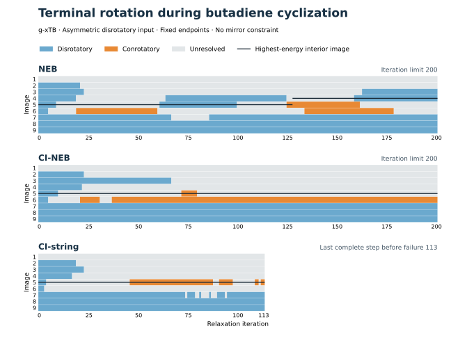

# ブタジエン環化の経路緩和ベンチマーク

1,3-ブタジエンからシクロブテンへの環化について、両端の原子対応を維持し、逆旋型の初期経路をNEB、CI-NEB、CI-stringで緩和した。全ての内部ノードが逆旋型の非対称な初期経路から、g-xTBで端点を固定して緩和したところ、3手法のいずれでも途中で最高エネルギーのノードが同旋型になった。経路全体が同旋型に収束した事例は、この試験では確認していない。

逆旋型の鏡映対称性を指定した標準経路では、3手法とも左右の末端回転が対応した。通常のNEBは収束したが、g-xTBの逆旋型CI-NEBとCI-stringは力の基準を満たさなかった。一方、別に作った同旋型の対照経路では、両方のCI法が低いエネルギーの頂点に収束した。

## 原子対応と測定量

[標準経路（9構造のXYZ）](./examples/butadiene-disrotatory.xyz)は中性・一重項のC₄H₆で、検証用に作成した。利用者の計算ファイルは使っていない。原子1–4が炭素骨格、H5・H6がC1、H9・H10がC4に結合する。H5とH9は反応物で内側を向く。鏡映で交換する原子対は **1–4、2–3、5–9、6–10、7–8**。s-cis型の平面ブタジエンとシクロブテンの座標をそれぞれ鏡映対称性の下でGFN2-xTBにより最適化し、原子ごとにCartesian座標を線形補間した。固定端点のエネルギー差は、この入力の反応物を基準にした値である。

- **回転角**　各末端で内側と外側の水素を結ぶベクトルを末端C–C結合に垂直な面へ射影し、炭素骨格を基準に符号付き角度を測る。左右で鏡映関係の回転が同符号になるように基準を取る。両方の末端が平面から10°以上傾いていれば、同符号を逆旋、異符号を同旋とする。0°または180°に近い末端を含むノードは未判定とした。
- **経路の分類**　毎ステップの全内部ノードを調べ、逆旋と同旋の両方があれば「混在」とする。反応座標上で最もエネルギーの高い内部ノード（以下「頂点」）での判定も別に記録する。原子の並べ替えは行わない。
- **鏡映誤差**　全構造に共通する鏡映面を最小二乗で求め、各原子と相手原子の鏡像の距離の最大値を測る。0.05 Åを初めて超えたステップと、同旋型の内部ノードが初めて現れたステップを別々に記録する。入力の検査で使う「鏡映対称部分空間へ射影した際の補正距離」は、鏡像間距離の半分にあたる。
- **収束**　バンドの最大有効力が0.05 eV/Å以下に達したかを判定する。表のΔEは頂点と反応物端点の物理エネルギー差。通常のNEBでは収束後もノードの間に真のエネルギー極大があり得る。CI法が上限に達した行のΔEは最終反復の値で、活性化障壁としては採用できない。

## g-xTBの標準経路

9ノード、端点固定、ばね定数1 eV/Ų、最大変位0.03 Å、CI開始はステップ5、上限200ステップ。逆旋型の2条件には同じ初期座標を渡した。内部の左右のCH₂基を互いに逆の面外方向に最大0.015 Åずらし、端点の変位はゼロとした。「鏡映」は初期誤差を射影した後も鏡映面と原子対を保持する。「同旋対照」では生成物で右のメチレン水素2個の対応を交換し、右の水素の面外回転を反転した。分子として同じ反応物・生成物の間の比較であり、逆旋型の計算が途中で切り替わったことを示す行ではない。

| 手法 | 入力と拘束 | 終了 | ステップ | 最大有効力（eV/Å） | ΔE（eV） | 頂点の左右の角度（°） |
|---|---|---|---:|---:|---:|---:|
| NEB | 逆旋・拘束なし | 収束 | 68 | 0.0461 | 3.019 | +57.85 / +58.00 |
| NEB | 逆旋・鏡映 | 収束 | 68 | 0.0471 | 3.018 | +57.93 / +57.93 |
| NEB | 同旋対照 | 収束 | 89 | 0.0376 | 2.034 | +46.37 / −46.37 |
| CI-NEB | 逆旋・拘束なし | 上限 | 200 | 4.5252 | 4.900 | +60.04 / +60.11 |
| CI-NEB | 逆旋・鏡映 | 上限 | 200 | 4.4942 | 4.914 | +60.13 / +60.13 |
| CI-NEB | 同旋対照 | 収束 | 85 | 0.0489 | 2.034 | +46.43 / −46.43 |
| CI-string | 逆旋・拘束なし | 上限 | 200 | 5.6213 | 4.007 | +50.14 / +50.21 |
| CI-string | 逆旋・鏡映 | 上限 | 200 | 5.4952 | 3.614 | +49.64 / +49.64 |
| CI-string | 同旋対照 | 収束 | 78 | 0.0451 | 2.034 | +46.44 / −46.44 |

標準入力の逆旋型6条件では、定義した角度基準を満たす同旋型の内部ノードは全ステップを通じて現れなかった。鏡映拘束下の3条件では鏡映誤差が10⁻¹² Å未満だった。逆旋型CIの4条件すべてで、あるノードの連続する座標間の実エネルギー変化が、前後の物理力から推定した変化を0.69 eV以上上回るか下回った。この警告の判定には人工ばねやCI補正の力を使わない。同旋対照3条件と通常の逆旋型NEBの2条件では警告は発生しなかった。

## 端点・初期経路を変えた試験

CI法の端点緩和では、両端に物理力を適用する。鏡映を有効にした場合は端点も鏡映対称部分空間で緩和する。g-xTBで標準経路の端点を緩和し、100ステップまで計算したところ、CI-NEBの最大有効力は拘束なしで2.78、鏡映ありで2.79 eV/Å、CI-stringではそれぞれ2.59、2.12 eV/Åだった。4条件とも途中に同旋型の内部ノードを検出しなかった。通常のNEBは固定端点で測定した。

炭素骨格の面外変位を与えず、末端CH₂の結合軸周りに鏡映を破る方向へ最大2.5°のねじれを加えた場合も、固定端の逆旋型CI-NEB・CI-stringでは、拘束の有無によらず200ステップ以内に角度の符号反転による同旋型の内部ノードを検出しなかった。さらに非対称な初期条件については次節に示す。

[別の初期経路（17構造のXYZ）](./tests/fixtures/butadiene-disrotatory-scan.xyz)はg-xTB上で、C1–C4距離と末端回転角を組み合わせた座標を段階的に固定し、鏡映対称性の下で他の自由度を緩和して作成した。C1–C4距離は3.022 Åから1.555 Åに変化する。この17構造から始めた固定端・鏡映のNEBは124ステップで0.0437 eV/Å、ΔEは3.475 eVだった。CI-NEBとCI-stringは各200ステップで7.74、5.57 eV/Åにとどまった。各頂点の左右の回転角は一貫して対応した。

## 同じ原子対応のまま回転が変わる例

[非対称な逆旋型の9構造](./tests/fixtures/butadiene-disrotatory-asymmetric.xyz)は標準経路と同一の端点を持つ。内部7構造で左右の回転をずらし、両末端の初期角を少なくとも+11°とした。初期の7構造すべてを逆旋型と判定できる。g-xTBで鏡映拘束を加えず端点を固定すると、3手法とも**内部の最高エネルギーのノードで同旋型への切り替わりが起きた**。表のノード番号はXYZの先頭を1とする。

| 手法 | 初めて同旋型になった内部ノード | 初めて頂点が同旋型になったステップ・ノード・角度 | 終了時の頂点と最大有効力 |
|---|---|---|---|
| NEB | 19ステップ、ノード6 | 125ステップ、ノード5、+114.57° / −10.39° | 200ステップ上限、逆旋、0.3994 eV/Å |
| CI-NEB | 21ステップ、ノード6 | 72ステップ、ノード5、+103.43° / −10.10° | 200ステップ上限、未判定、0.6557 eV/Å |
| CI-string | 46ステップ、ノード5 | 46ステップ、ノード5、+106.58° / −10.21° | 最終完全評価113ステップ、同旋、0.3036 eV/Å。次の評価でSCF未収束 |

変更前の `9082468` のブリッジでも、同じ入力・固定端でCI-stringを計算すると、ステップ34でノード6が初めて同旋型となり、ステップ39では頂点のノード5が+106.22° / −10.73°となった。143ステップ完了後にSCFが未収束となった。変更前のNEBとCI-NEBは135ステップまで追跡し、内部ノード・頂点で初めて同旋型となったステップは表と一致した。CI-stringの再配置を修正すると、頂点での切り替わりは39ステップから46ステップに変化したが、鏡映拘束なしでは乗り移りが起きた。変更後の拘束なしの計算で最終完全評価したCI-stringの頂点は+114.09° / −10.27°で、経路には逆旋型のノードも残った。初期経路は既に左右非対称（鏡映誤差1.375 Å）だが、初めて同旋と判定したステップは0ではない。鏡映拘束を既定値で指定した場合は、初期補正の最大0.700312 Åが許容値0.05 Åを超えるため、全3手法が電子状態計算の前に入力を返した。



同じ非対称XYZについて、鏡映の初期補正上限を明示的に0.71 Åへ上げ、3手法を再計算した。全手法で実際の最大補正は0.700312 Å、固定端点の変位は厳密に0 Åだった。200ステップにわたって全経路の鏡映誤差は0 Åで、同旋型の内部ノードは一度も現れなかった。NEB、CI-NEB、CI-stringの最終最大有効力はそれぞれ0.8806、5.0681、4.0880 eV/Åで、いずれも収束基準を満たしていない。頂点の左右の角度は順に+57.59°、+51.68°、+52.72°で一致した。通常のNEBで反復上限を1000に上げると、388ステップで0.0494 eV/Åに収束した。頂点の左右の角度は+59.27° / +59.27°、ΔEは2.781 eVであり、途中も同旋型の内部ノードは現れなかった。これは**最初に内部ノードを対称化して、選んだ逆旋経路を保持した計算**である。初期の非対称な内部座標そのものは変化する。

同じ標準端点を使い、別の非対称変形として末端結合軸周りにねじれを加え、両端を緩和するCI法でも確認した。

- **g-xTB、CI-string、25°**　ステップ99で初めてノード5が同旋型となり、その回転角は−10.21° / +134.31°で、その時点の最高エネルギーは逆旋型のノード6にあった。200ステップまで同旋型の頂点は現れず、力は2.62 eV/Åにとどまった。35°では、118ステップ完了後の電子状態計算がSCF反復250回で収束せず停止した。
- **GFN2-xTB、CI-NEB、35°**　ステップ34でノード5が頂点となり、回転角は−10.51°と+104.98°だった。他に逆旋型のノードも残っていた。200ステップで力は収束しなかった。

対称性を使う場合、既定では最大0.05 Åの範囲で初期構造を補正する。これを超える補正を許可すると、入力した非対称な中間構造を対称化した座標から緩和する。

## 頂点の電子状態と振動数

逆旋型の拘束スキャンの障壁付近から採った[鏡映対称な2構造](./tests/fixtures/butadiene-gxtb-scf-probe.xyz)を、公式g-xTBで個別に再計算した。原子あたりの最大変位は7.36×10⁻⁸ Åだったが、独立な初期電子状態からのエネルギー差は+0.593670 eV、変位方向のエネルギー勾配は+3.820と−5.214 eV/Åだった。片方で得た波動関数をもう片方の初期値として使うと、高低2通りの自己無撞着場（SCF）解を両構造で得た。この局所的な解の切り替わりは、幾何学的に鏡映対称な経路でも、CIの上昇方向を決める勾配が不連続になり得ることを示す。[SCFの再計算スクリプト](./scripts/probe_butadiene_gxtb.py)

GFN2-xTBでは先に通常のNEBを69ステップで緩和し、CI-stringの最大変位を0.015 Åへ下げて最初のステップからCIを有効にすると、鏡映拘束の下で500ステップ、最大有効力0.0448 eV/Å、ΔE 3.605 eVに達した。頂点のC1–C4距離は2.465 Å、回転角は+57.99° / +57.99°だった。同じ2段階の計算をg-xTBで行うと、550ステップ後の最大有効力はCI-stringで5.48、CI-NEBで8.33 eV/Åだった。

収束したGFN2-xTBの逆旋型CI-string頂点で、鏡映拘束を外して全Cartesian座標の力を中心差分し、質量重み付きHessianから並進・回転を除いた。変位幅0.001 Åで約3424i cm⁻¹（鏡映を保つ変位）と444i cm⁻¹（鏡映を破る変位）の2モードが得られ、0.0005および0.002 Åでも同じ2方向に負の曲率があった。この構造を1次の遷移状態とする根拠は得られなかった。対照のg-xTB同旋型CI頂点では、変位幅0.005、0.010 Åの双方で負の振動モードは各1個（CI-NEB 約806i cm⁻¹、CI-string 約809i cm⁻¹）だった。この試験にIRC追跡は含まない。[振動数を検証するスクリプト](./tests/benchmark_butadiene_modes.py)

関連する理論研究では、QuappとBofillがシクロブテン開環について、同旋経路に1次、逆旋経路に2次の鞍点を報告している。上記のg-xTB・GFN2-xTBで計算した曲率は、本ベンチマークの独立な測定値である。[Quapp & Bofill, International Journal of Quantum Chemistry (2015)](https://diposit.ub.edu/items/d98c8f23-9818-457c-8c73-25ada71fdaa5)

## 再現手順

リポジトリのルートで実行する。測定環境はLinux x86-64、Python 3.12.14、NumPy 2.5.5、ASE 3.29.0、tblite 0.8.0。[公式g-xTB v2.0.1](https://github.com/grimme-lab/g-xtb/releases)の `xtb-6.7.1-gxtb-140526-linux-x86_64` を使用した。実行ファイルのSHA-256は `1b4e30b68ed4e88b4075f60d97f4756ee440fe92d3294cc20826d53f8121cd26`。並列化は異なるノード間だけで行い、各電子状態計算は1スレッドとした。[エンジンの導入手順](./local-engine/README.md)

```bash
export GXTB_TEST_BINARY=/absolute/path/to/xtb
export OMP_NUM_THREADS=1 OPENBLAS_NUM_THREADS=1 MKL_NUM_THREADS=1
bench=molecule-visualizer/tests/benchmark_butadiene.py
modes=molecule-visualizer/tests/benchmark_butadiene_modes.py

python "$bench" --engine gxtb --workers 2 --json standard.json
python "$bench" --engine gxtb --workers 3 --input molecule-visualizer/tests/fixtures/butadiene-disrotatory-asymmetric.xyz --case free --mode neb cineb lup --distortion 0 --steps 200 --endpoint-mode fixed --json asymmetric.json
python "$bench" --engine gxtb --workers 3 --input molecule-visualizer/tests/fixtures/butadiene-disrotatory-asymmetric.xyz --case mirror --mirror-tolerance .71 --distortion 0 --json asymmetric-projected.json
python "$bench" --engine gxtb --workers 4 --input molecule-visualizer/tests/fixtures/butadiene-disrotatory-asymmetric.xyz --mode neb --case mirror --mirror-tolerance .71 --distortion 0 --steps 1000 --json asymmetric-neb.json
python "$bench" --engine gxtb --workers 2 --case free mirror --mode cineb lup --endpoint-mode relax --steps 100 --json relaxed-ends.json
python "$bench" --engine gxtb --workers 2 --case free mirror --mode cineb lup --distortion 0 --twist-deg 2.5 --json twist-2p5.json
python "$bench" --engine gxtb --workers 2 --case mirror --input molecule-visualizer/tests/fixtures/butadiene-disrotatory-scan.xyz --json scan.json
python "$bench" --engine gxtb --workers 2 --mode lup --case free --endpoint-mode relax --distortion 0 --twist-deg 25 --json twist-25.json
python "$bench" --engine tblite --mode cineb --case free --endpoint-mode relax --distortion 0 --twist-deg 35 --json twist-35.json
python "$bench" --engine tblite --mode lup --case mirror --pre-relax --max-move .015 --climb-after 0 --steps 550 --json staged.json
python "$bench" --engine gxtb --workers 2 --mode cineb lup --case mirror --pre-relax --max-move .015 --climb-after 0 --steps 550 --json staged-gxtb.json
python "$modes" standard.json --mode cineb --case con --delta .005 .010
python "$modes" standard.json --mode lup --case con --delta .005 .010
python "$modes" staged.json --mode lup --case mirror --delta .0005 .001 .002
python molecule-visualizer/tests/plot_butadiene_trace.py asymmetric.json --output asymmetric-branches.svg
python molecule-visualizer/scripts/probe_butadiene_gxtb.py
python -m unittest discover -s molecule-visualizer/tests -p 'test_butadiene_path.py' -v
```

JSONの `reason` は `converged`（基準達成）、`step_limit`（上限）、`failed`（実行失敗）を区別する。`trace` は全ノードの評価が完了したステップだけを収録し、頂点番号・エネルギー差・左右の回転角・各ノードの分類を保存する。`firstConrotatoryInterior` と `firstConrotatoryPeak` はそれぞれ最初に該当したステップとノード番号（1始まり）を示す。電子状態計算の失敗時は、最後に完全評価できた経路とエネルギーを `failure` に保存し、独立した他の条件を引き続き実行する。
